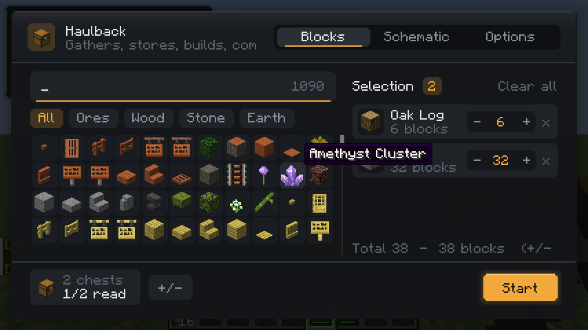
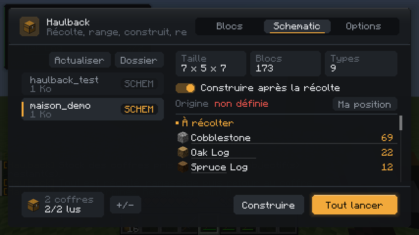
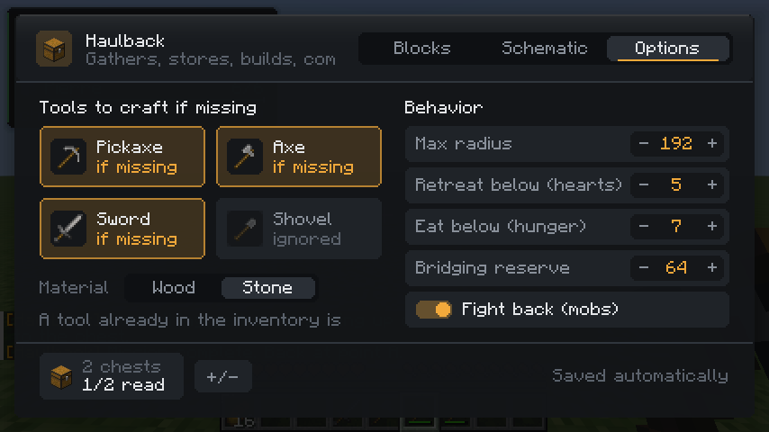
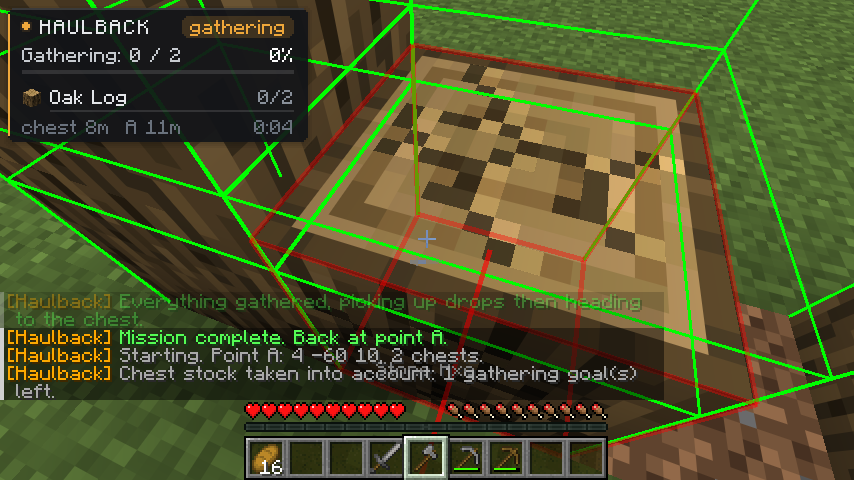
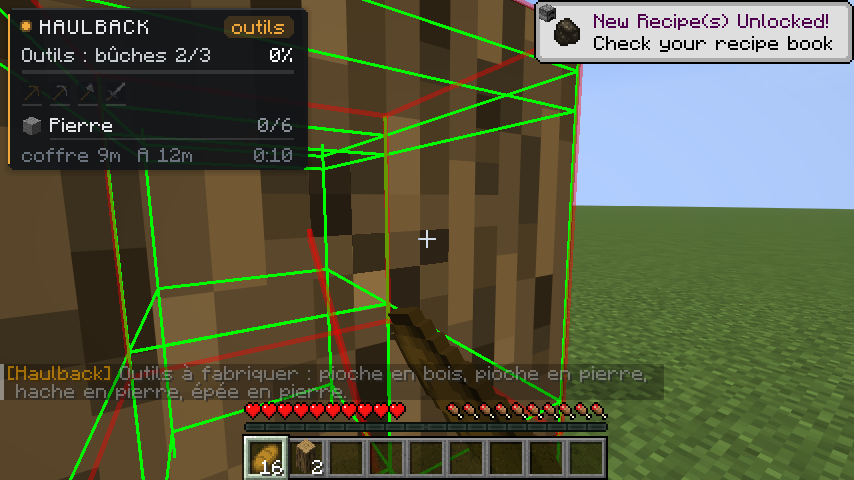
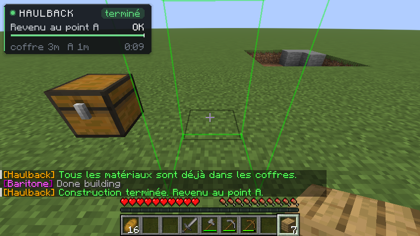

<p align="center"></p>

<h1 align="center">Haulback</h1>

<p align="center">
A client-side Fabric mod for Minecraft 1.21.11, built on <a href="https://github.com/cabaletta/baritone">Baritone</a>.<br>
Pick some blocks or a schematic: it gathers everything, processes it, stores it in your chests, builds if you want, then walks back to where it started.
</p>

<p align="center">
<a href="https://github.com/achedon12/haulback/releases"></a>
<a href="https://www.curseforge.com/minecraft/mc-mods/haulback"></a>
<a href="https://github.com/achedon12/haulback/releases/latest"></a>
</p>

<p align="center">
<a href="https://achedon12.github.io/haulback/">Website</a> ·
<a href="https://github.com/achedon12/haulback/wiki">Wiki</a> ·
<a href="https://github.com/achedon12/haulback/releases">Download</a>
</p>

---

## Features

- **Block mode**: choose one or more blocks from an icon grid, set a quantity, and the bot mines them.
- **Schematic mode** (`.litematic`, `.schem`, `.schematic`): reads the exact bill of materials and walks the recipe tree down to raw resources (planks to logs, glass to sand, stairs to their base block...).
- **Automatic workshop**: places a crafting table and furnaces next to your chests, smelts (glass, stone, bricks, ingots...) and crafts (planks, sticks, stairs, slabs, panes...) everything the build needs, with fuel handled for you.
- **Building**: Baritone builds the schematic at the chosen origin, pulling blocks from your chests.
- **Multiple chests**: before starting, the bot visits every selected chest, reads its contents and **subtracts what you already have**, intermediates included.
- **Tools**: crafts whatever is missing (pickaxe, axe, sword, shovel), from wood up to stone. If the blocks require it, it mines iron and coal, smelts the ingots and crafts an iron pickaxe, then a diamond one. A tool already in the inventory is never crafted again.
- **Survival**: eats when hungry, heads home to heal when health drops, fights hostile mobs (skeletons shooting from a distance included) and never provokes neutral mobs.
- **Human-like movement**: the camera follows the path and the block being mined, with smoothed rotations.
- **Always comes back** to the starting point, within a configurable maximum radius.

## Screenshots

| Block picker | Schematic | Options |
|---|---|---|
|  |  |  |

| HUD while gathering | Crafting tools | Mission complete |
|---|---|---|
|  |  |  |

## Installation

1. Fabric Loader 0.18.2+ and Fabric API for Minecraft 1.21.11.
2. [Baritone **API** for Fabric 1.17.0](https://github.com/cabaletta/baritone/releases/tag/v1.17.0): the `baritone-api-fabric-1.17.0.jar` file. The "standalone" build will not work, Haulback needs the API.
3. The Haulback jar from the [releases](https://github.com/achedon12/haulback/releases).

Both jars go into your `mods` folder. With Lunar Client, add them to your Fabric profile (`mods/fabric-1.21.11` inside the profile folder).

Haulback is **client-side only**: nothing to install on the server.

## Usage

| Key | Action |
|---|---|
| `H` | Open the interface |
| `J` | Add or remove the chest you are looking at |
| `K` | Stop the running mission, or restart the last one |

1. Look at a chest and press `J` (repeat to add more).
2. Open the interface with `H`, pick blocks or a schematic.
3. For a schematic, pick a mode: **Materials** (gather and process only), **Build** (build from what is in your chests) or **Both**. To build, stand where the schematic should start and click **My position**.
4. Start. The HUD in the top-left corner tracks the mission; `K`, **Stop** in the interface or `/haulback stop` cancels it.

Keys are rebindable in Options > Controls. The `/haulback` command (alias `/hb`) offers `start`, `stop`, `toggle`, `status`, `open` and `chest add|list|clear`.

Schematics go into the game's `schematics` folder (**Folder** button in the interface). The interface is available in English, French, German and Spanish and follows your game language. See the [wiki](https://github.com/achedon12/haulback/wiki) for a full walkthrough.

## Known limitations

- Netherite is out of scope: the bot stops at diamond tools.
- Items that cannot be crafted or smelted from mined blocks (wool, dyes, mob drops...) are listed as "to provide yourself"; you can force a direct search for them.
- Baritone mines whatever matching blocks it finds: on a shared server it may break a build made of the same blocks. Keep a sensible radius.
- A bot is still a bot: check that your server's rules allow it.

## Building from source

```bash
./gradlew build                # jar in build/libs
./gradlew runClientGameTest    # end-to-end scenarios in a real client
```

The in-game tests cover: crafting tools from an empty inventory, gathering with stock deduction across two chests, building a schematic, the automatic workshop (smelting and crafting), the iron pickaxe chain, and fighting a zombie and a skeleton.

## Contributing

Contributions are welcome: bug reports, translations, docs and code. Start with [CONTRIBUTING.md](CONTRIBUTING.md) and [docs/ARCHITECTURE.md](docs/ARCHITECTURE.md). Adding a language only takes a JSON file.

## License

LGPL-3.0, like Baritone.
